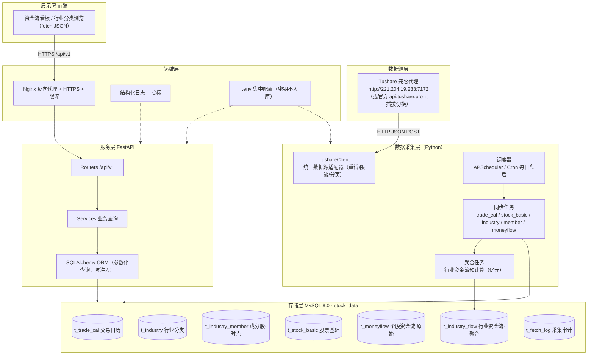

# 申万行业资金流看板 · 架构设计

> 版本：v1.2　|　面向：客户演示 / 生产部署　|　密级：内部
> **文档性质**：本文档描述**目标架构**（设计意图）。截至 v1.1 的实际实现状态见下方「实现状态总览」。

## 实现状态总览

> 核对基准：`backend/` 实际代码（`app/main.py`、`etl.py`、`schema.sql`）。

| 能力 | 状态 | 说明 |
|------|------|------|
| 数据采集 ETL（建表 + 同步 + 聚合） | ✅ 已实现 | `backend/etl.py`，幂等可重跑 |
| 行业分类 / 成分股 / 个股资金流入库 | ✅ 已实现 | 成分股同步 **L2(134) + L3(346)** |
| 行业资金流聚合 | ✅ 已实现 | **L1 + L2 + L3 三级** |
| FastAPI 服务层（13 个接口） | ✅ 已实现 | 单文件 `app/main.py`，非分层目录 |
| 前端接入真实数据 | ✅ 已实现 | `fundflow.html` / `industry.html` 已替换 mock |
| FastAPI 托管静态前端 | ✅ 已实现 | `StaticFiles` 挂载 `backend/static/` |
| SQLAlchemy ORM | ⚠️ 偏离 | 实际为 pymysql + 参数化 SQL（注入防护等价） |
| Alembic 迁移 | ⚠️ 偏离 | 实际用 `schema.sql`（`CREATE TABLE IF NOT EXISTS`，不支持字段变更回滚） |
| pydantic-settings | ⚠️ 偏离 | 实际用 python-dotenv + `config.py` |
| `t_fetch_log` 采集审计 | ⚠️ 偏离 | 表已建，但 ETL 尚未写入（采集进度改由 `GET /admin/log` 暴露） |
| 定时调度（APScheduler/Cron） | ❌ 未实现 | 仅 `POST /api/v1/admin/fetch` 手动触发 |
| 只读数据库账号（`stock_read` / `stock_etl`） | ❌ 未实现 | 当前应用使用 `root` |
| 管理接口鉴权（`X-Admin-Key`） | ✅ 已实现 | `ADMIN_KEY` 未配置或为默认值 → `/api/v1/admin/*` **一律拒绝（fail closed）** |
| 采集真实进度（`GET /admin/log`） | ✅ 已实现 | 返回 `backend/etl_run.log` 尾部 |
| 读接口鉴权（`X-Api-Key`） | ❌ 未实现 | 读接口无鉴权 |
| 缓存（Redis / 进程内 TTL） | ❌ 未实现 | — |
| Nginx + HTTPS | ❌ 未实现 | 当前 uvicorn 直接监听 `127.0.0.1:8000`（HTTP） |
| Docker Compose / Dockerfile | ❌ 未实现 | — |

## 1. 项目定位

面向客户展示 **申万行业（一/二/三级）分类 + 行业/个股资金流** 的可视化看板。
数据为**真实行情数据**，由后端每日从数据源同步并聚合到 MySQL，前端只读展示，**不使用任何模拟数据**。

## 2. 现状勘察结论（决定本方案的依据）

| # | 结论 | 影响 |
|---|------|------|
| 1 | 现有看板（`fundflow.html` 等）资金流为**前端伪随机 mock** | 给客户看前必须替换为真实数据 |
| 2 | 数据源为 **Tushare 兼容代理** `http://221.204.19.233:7172`，token 位于 `C:\Users\57424\jsdata_tk.csv`（56 位，非官方 40 位） | 依赖第三方代理；官方 `api.tushare.pro` 不认此 token |
| 3 | 现有 `fetch_industry_flow.py` 请求 `/query`、解析 `ok/error/rows`，与代理当前返回的 `code/msg/data` 契约**不匹配** | 采集脚本需重写 |
| 4 | 代理已验证支持 `moneyflow`、`index_member`、`trade_cal`，返回官方 `fields/items/has_more` 结构 | 可直接对接，但需处理分页与限流 |
| 5 | 本机 MySQL 8.0 已运行（`stock_data` 库）、Docker/Python3.13/Node 可用 | 无需额外基础设施 |

> 安全提醒：数据源为 **HTTP 明文** 且 token 走请求体。生产环境需评估改用官方 Tushare Pro（HTTPS）或为该代理加 HTTPS 网关。

## 3. 总体架构



### 分层职责（文字版）

| 层 | 职责 | 关键约束 |
|----|------|----------|
| 数据源层 | 提供行情/分类原始数据 | 网络只读；不把 token 暴露给前端 |
| 采集层 ETL | 定时拉取、清洗、聚合、入库 | 幂等可重跑、断点续传、失败重试、时点成分 |
| 存储层 MySQL | 落库原始 + 聚合数据 | utf8mb4、InnoDB、索引覆盖查询、只读账号给 API |
| 服务层 FastAPI | 对外 REST API、鉴权、缓存、限流 | 参数化查询、统一错误码、响应脱敏 |
| 展示层 前端 | 渲染看板，仅通过 API 取数 | 不在前端伪造数据；静态资源走 Nginx |
| 运维层 | HTTPS、日志、监控、配置 | 密钥只存在于 `.env`，不进 git |

## 4. 数据流

```
盘后定时任务（工作日 17:30）
  ├─ ① 同步交易日历 trade_cal（增量）
  ├─ ② 同步股票基础 stock_basic（增量）
  ├─ ③ 同步行业分类 industry（全量，31 一级 + 134 二级 + 346 三级）
  ├─ ④ 同步成分股 index_member（时点：in_date/out_date，覆盖历史调入调出；只挂 L2/L3）
  ├─ ⑤ 同步个股资金流 moneyflow（逐交易日**全市场**拉取，增量；成分过滤在聚合层做）
  └─ ⑥ 聚合行业资金流 t_industry_flow（小/中/大/超大单 → 净额，万元→亿元）
         ↓
前端请求 GET /api/v1/... → FastAPI 查询 MySQL → JSON 返回
```

## 5. 技术选型

| 组件 | 设计选型 | 实际实现 | 状态 |
|------|----------|----------|------|
| 后端框架 | FastAPI + Uvicorn | FastAPI + Uvicorn | ✅ 一致 |
| 数据访问 | SQLAlchemy 2.x ORM | **pymysql + 参数化 SQL** | ⚠️ 偏离（安全性等价） |
| 数据库迁移 | Alembic（版本化、可回滚） | **`backend/schema.sql`（幂等建表，不可回滚）** | ⚠️ 偏离 |
| 配置 | pydantic-settings + `.env` | **python-dotenv + `config.py`** | ⚠️ 偏离 |
| 数据库 | MySQL 8.0（复用本机实例） | MySQL 8.0 `stock_data` | ✅ 一致 |
| 采集调度 | APScheduler（进程内）或 Cron | **`POST /api/v1/admin/fetch` 手动触发** | ❌ 未实现调度 |
| 缓存（可选） | Redis / 进程内 TTL | 进程内 TTL 60s（`/industries`、`/tree`、`/strength`；`API_CACHE_TTL=0` 可关） | ✅ 已实现（进程内） |
| 部署 | Docker Compose（API + Nginx） | **uvicorn 直接监听，FastAPI 托管静态文件** | ❌ 未实现 |
| 前端 | 复用现有 HTML，改为 `fetch` 调 API | 复用现有 HTML + `fetch` | ✅ 一致 |

## 6. 安全设计

1. **密钥管理**：DB 密码、数据源 token、API Key 全部放 `.env`（提供 `.env.example`），**禁止写入源码或数据库**；`.gitignore` 排除 `.env`。
2. **传输加密**：对外统一 Nginx HTTPS；数据源若可用官方 `api.tushare.pro`（HTTPS）优先，代理仅作回退。
3. **最小权限**：API 连库使用**只读账号** `stock_read`（`SELECT` only），采集使用 `stock_etl`（读写）；禁用 root 给应用。
4. **鉴权**：读接口可选 `X-Api-Key`（未实现）；管理接口（触发采集）必须 `X-Admin-Key`
   —— 已实现且为常量时间比较，另有**可选** IP 白名单（`ADMIN_IP_ALLOWLIST`，默认为空=不限制）
   与限流（默认 30 次/分钟/IP）。
5. **注入防护**：全量走参数化查询（未采用 SQLAlchemy 但仍为参数化），禁止拼接 SQL；输入校验用 Pydantic / 显式校验函数。
6. **限流**：Nginx `limit_req`（未部署）+ 接口级限流（仅管理接口，P4 目标里的读接口限流未实现）。
7. **日志脱敏**：不记录 token、密码、手机号等；日志含 `traceId` 便于排障。
   —— 已实现：API 访问/异常日志写入 `backend/api_run.log`，`traceId` 同时进响应体与响应头 `X-Trace-Id`；
   500 响应体固定为 `internal error`，不再回显异常原文。

## 7. 部署拓扑

```
                         ┌─────────────────────────────┐
  客户浏览器 ──HTTPS──▶  │  Nginx (443, 静态资源+反代)  │
                         └──────────────┬──────────────┘
                                        │ /api/v1
                         ┌──────────────▼──────────────┐
                         │  FastAPI (uvicorn :8000)    │──▶ MySQL 8.0 :3306
                         └──────────────┬──────────────┘
                                        │ 盘后定时
                         ┌──────────────▼──────────────┐
                         │  ETL 采集（同容器或独立）     │──▶ 数据源代理
                         └─────────────────────────────┘
```

- 单机演示：`docker compose up` 起 Nginx + API + ETL，MySQL 用本机实例。
- 生产：MySQL 建议独立/主从，API 可横向扩展（无状态），ETL 单实例（防并发写冲突）。

## 8. 可观测性

- 结构化日志（JSON）：**未实现**。当前为纯文本：ETL 写 `backend/etl_run.log`，
  API 访问/异常写 `backend/api_run.log`（每行带 `trace=n`，可凭响应体/响应头里的 `traceId` 对账）。
  请求日志、慢查询日志、JSON 格式仍待补。
- 采集审计：✅ `t_fetch_log` 记录每次任务 `status/start_at/end_at/rows_fetched/rows_written/error_msg`
  （v1.3 起真正写入；同时作为 `/admin/fetch` 的跨进程并发护栏）。
- 健康检查：✅ `GET /api/v1/health` 返回 DB 连通性与最新数据日期；**DB 挂掉时返回 200 + `db=down`**
  （而不是 500），便于探针区分「服务存活」与「依赖不可用」。

## 9. 实施路线（分阶段）

| 阶段 | 内容 | 验收标准 | 状态 |
|------|------|----------|------|
| P0 数据层 | 建库建表（迁移脚本）、重写 `TushareClient` 适配代理契约 | 能正确拉取并入库，`t_fetch_log` 有记录 | ✅ 已完成（v1.3 起 `t_fetch_log` 真正写入；通用分页 `_call_paged` 已补） |
| P1 服务层 | FastAPI 骨架 + 行业/资金流/搜索接口 | 接口返回真实数据，通过 pytest | ✅ 已完成（13 接口；pytest 78 项：离线 57 + 集成 21） |
| P2 展示层 | 现有 HTML 改 `fetch` 调 API，替换 mock | 页面数据与库中一致，标注数据日期 | ✅ 已完成（mock 死代码清理见前端清单） |
| P3 运维 | Nginx+HTTPS、`.env`、只读账号、定时任务、监控 | 一键部署，密钥不落盘 | ⬜ 未开始 |
| P4 加固 | 缓存、限流、告警、数据源切换官方 Tushare | 压测 + 断网/限流演练 | 🟡 部分（进程内 TTL 缓存 + 管理接口限流已做；只读账号/告警/官方源未做） |

## 10. 风险与回滚

| 风险 | 等级 | 缓解 | 回滚 |
|------|------|------|------|
| 数据源代理不可用/变更契约 | 高 | 数据源适配器可插拔，支持官方 Tushare 切换；采集失败告警 | 回退到最近一次成功快照数据 |
| HTTP 明文泄露 token | 高 | 改官方 HTTPS / 加加密网关 | 立即轮换 token |
| 采集产生脏数据 | 中 | 幂等 + `trade_date` 唯一键 + 先写临时再替换 | 按日期删除重跑 |
| DB 结构变更 | 中 | Alembic 版本化迁移（**未实现**；当前靠 `schema.sql` 的 `CREATE TABLE IF NOT EXISTS`，加字段/改索引**不会生效**） | 手工 `ALTER` + 反向 `ALTER`；改结构前先 `mysqldump` 备份 |
| 前端展示与数据口径不一致 | 中 | 统一「亿元、4 位小数、YYYYMMDD」口径，meta 接口带数据日期 | 回退前端版本 |

## 11. 待确认事项

1. 数据源是否可申请**官方 Tushare Pro token**（40 位、HTTPS）？当前 56 位 token 仅代理可用。
2. 代理 `221.204.19.233:7172` 是否支持 **HTTPS**、是否有调用频率/并发限制？
3. 前端是否接受「盘后 T+0 数据」（资金流为收盘后更新），还是需要盘中实时？
