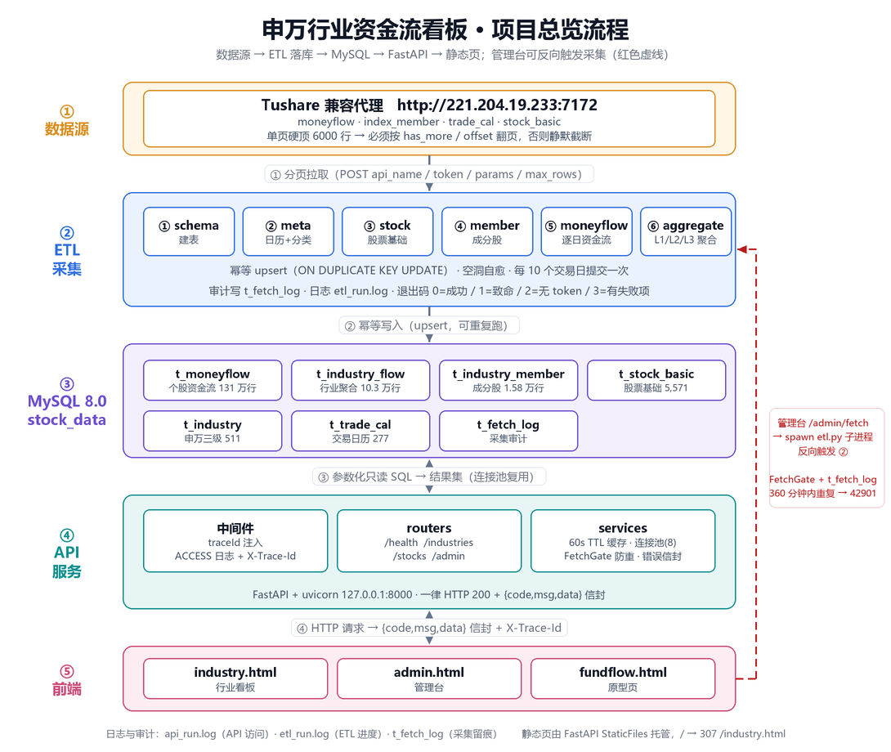
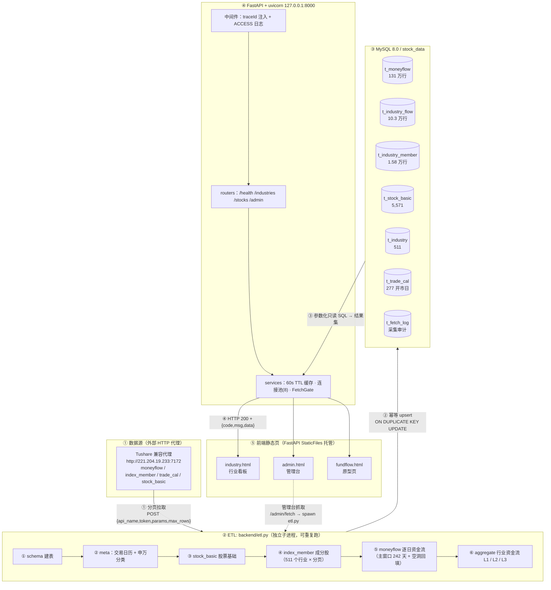
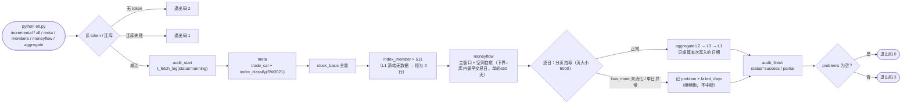
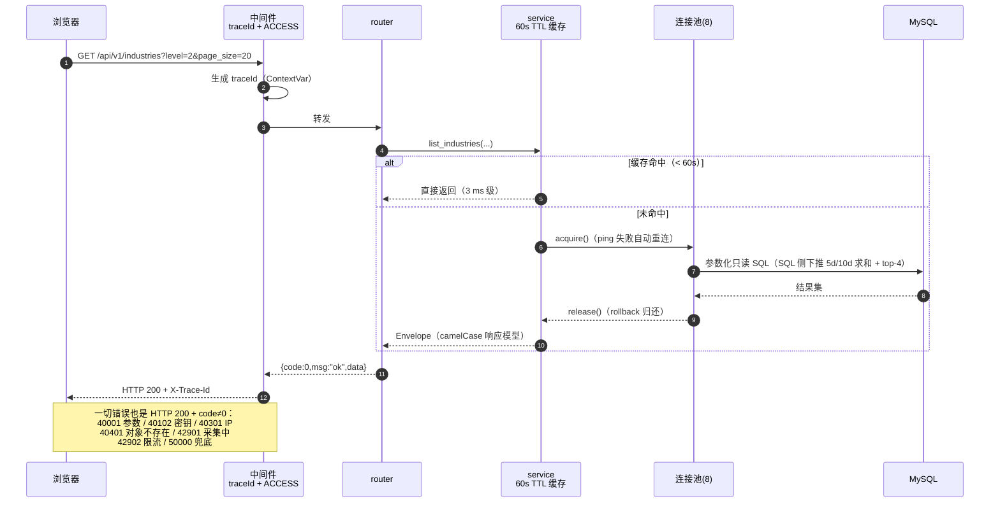
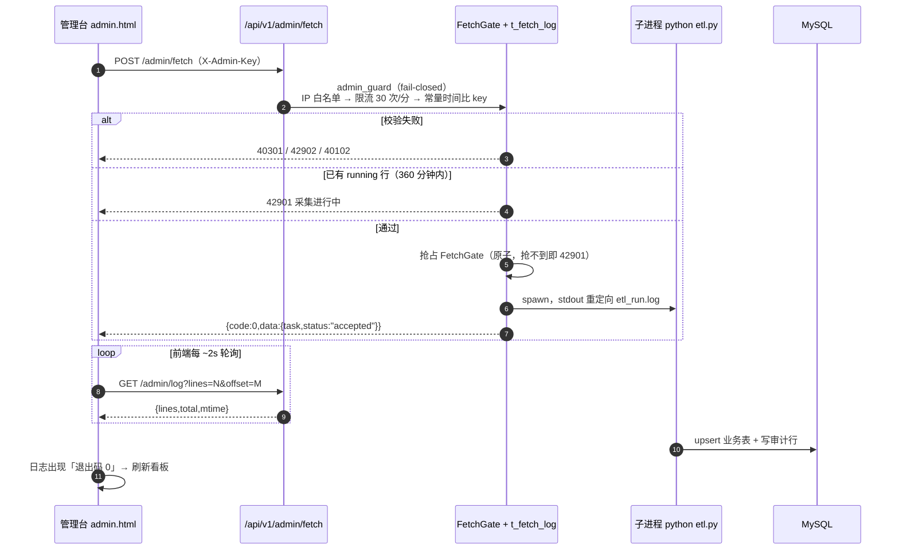
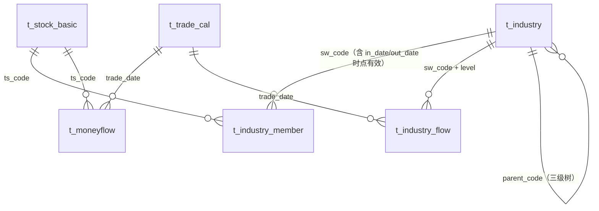
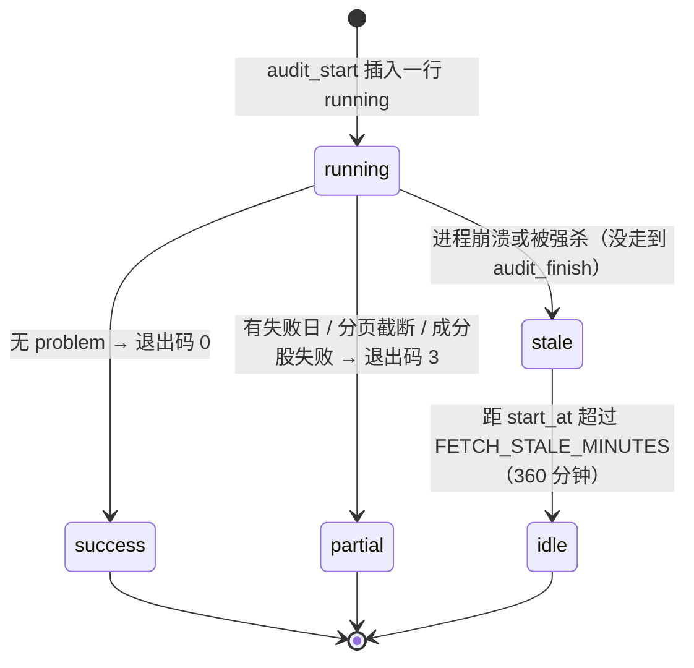

# 08 · 项目流程图

> 日期：2026-10-17　|　对象：`C:\[AI工作区]\biancheng`（= `git@github.com:Song-Jian-Coder/sj_homepage_one.git`）
> 配套位图：`docs/images/项目总览流程图.png`（1090×920，由 `backend/tools/render-flow.py` 用 Pillow 代码绘制，**不是手绘**，改布局后重跑即可保持一致）
> 下面的 mermaid 图在 GitHub 网页上会直接渲染；本地可用 Typora / VS Code 预览。

---

## 0. 总览（位图）



五条泳道自上而下：**数据源 → ETL 采集 → MySQL 存储 → API 服务 → 前端页面**。
红色虚线是唯一的反向链路：管理台点「抓取」时反向触发 ETL 子进程。

重新生成：

```bash
cd backend
python tools/render-flow.py                  # 默认写 docs/images/项目总览流程图.png
python tools/render-flow.py --out 临时.png    # 换输出路径
```

---

## 1. 端到端数据流



关键约束：

- **单向为主**：数据只能从源 → ETL → 库 → API → 页面；唯一反向链路是管理台触发采集。
- **采集与查询解耦**：API 只读库，Never 直接调数据源；采集失败不影响看板可用（读到的是上次成功的数据 + `asOf` 日期）。
- **前端不做二次计算**：金额统一「亿元」，聚合在 ETL 里算好，页面只渲染。

---

## 2. ETL 采集流水线



设计要点（每条都有对应事故或审查项）：

| 机制 | 为什么必须有 |
|---|---|
| 分页按「实回行数」推进 offset | 服务端硬顶 6000 行/页，`t_stock_basic` 已达 93% 容量，不翻页就静默截断 |
| 幂等 upsert | 任何一天都能单独重跑，`incremental` 可反复执行 |
| 空洞自愈 | 断点/漏采的交易日无需人工 SQL，下一轮自动回填 |
| 逐日 try/except + `failed_days` | 单日失败不能拖垮整轮，但**必须体现在退出码**（0 以外的 3） |
| 审计行 `t_fetch_log` | API 靠它判断「是否已有采集在跑」（跨进程护栏） |
| 聚合只算写入日期 | 242 天全量重聚合要 44 s，增量应接近 0 |

---

## 3. 一次 API 请求的生命周期



---

## 4. 管理台触发采集（唯一的反向链路）



要点：

- **两层防重**：进程内 `FetchGate`（原子占锁，worker 结束才释放）+ 数据库 `t_fetch_log` 的 running 行（跨进程、跨重启有效；超过 `FETCH_STALE_MINUTES=360` 视为崩溃残留）。
- **ETL 是子进程**：`etl.py` 改完立即生效，**不需要重启 uvicorn**；`app/**` 改完才需要重启。
- 采集期间 API 只读路径不受影响（不同连接）。

---

## 5. 数据表关系



三处容易踩的口径：

1. `t_industry_member` 用 `in_date / out_date` 做**时点成分**：聚合某日资金流必须按 `in_date <= trade_date < out_date` 关联，不能直接 join「当前成分」。
2. `t_industry_flow` 是**物化聚合结果**（`level` 1/2/3），源数据变了要重算，不能直接读 `t_moneyflow` 现场算。
3. `t_industry_member` 里 **L1 恒为 0 行**：一级行业由二级聚合而来（`parent_code`），这是设计，不是漏采。

---

## 6. 采集任务状态机（`t_fetch_log.status`）



`partial` 是**部分成功**，不是失败：已写入的交易日有效，重跑 `incremental` 会自动补齐未完成的日期。

---

## 7. 与其它文档的对应关系

| 本文 | 想看细节去哪 |
|---|---|
| 分层与部署形态 | `docs/01-架构设计.md` |
| 每个模块的职责与函数 | `docs/02-模块说明.md` |
| 接口字段、错误码全集 | `docs/03-接口文档.md` |
| 审查发现与整改项 | `docs/05-审查报告_2026-10-06.md`、`docs/06-后端修复报告_2026-10-06.md` |
| 前端改动明细 | `docs/07-前端修改报告_2026-10-06.md` |

图与实现不一致时，**以代码为准**（`backend/app/**`、`backend/etl.py`），并回来修本文与位图脚本。
